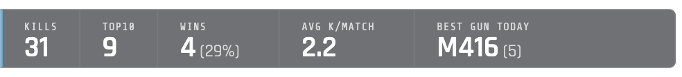
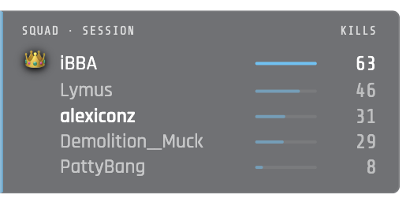
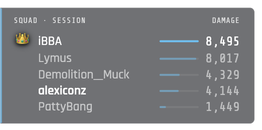

# PUBG Stream Overlay

A Three.js + Node.js stream overlay system for PUBG. Two scenes — an animated "starting soon" intro and a live in-game stats overlay — served from a single local server.

---

## Scenes at a glance

| Scene | URL | Purpose |
|---|---|---|
| **Intro** | `http://localhost:3001/intro.html` | Animated countdown ("Starting Soon → Starting Now"). Pan, M416, grenade rise from an ink ocean. Runs until your stream starts. |
| **Overlay** | `http://localhost:3001/overlay.html` | Transparent HUD for in-game. Live session stats and squad panel. |

Both scenes pull the player name from `PLAYER_NAME` in `.env` automatically — no URL params needed for normal use.

---

## Overlay — in-game HUD

`http://localhost:3001/overlay.html`

### What's on screen

| Element | Position | Description |
|---|---|---|
| **Session strip** | Top-left | KILLS · TOP10 · WINS (win%) · cycling stat · BEST GUN TODAY |
| **Cycling stat** | In strip | Rotates every 7s: HS% → AVG K/MATCH → LONGEST → LAST MATCH placement |
| **Squad / Duo panel** | Bottom-left | Per-teammate session stats, cycling every 7s between KILLS and DAMAGE — plus TEAM KILLS, which only joins the cycle once at least one has occurred |
| **IN THE SLUMP banner** | Above session strip | Appears after 3 consecutive zero-kill matches. Disappears the moment you get a kill. Preview with `?demo=slump`. |
| **ON FIRE banner** | Above session strip | Appears after 3 wins in a row. Animated flame emoji. Disappears on any non-win. Preview with `?demo=fire`. |

Stats accumulate **across all of today's matches** — not just since the server started.

#### Session strip



#### Squad panel — cycles every 7s

The squad panel sorts by whichever metric it's currently displaying, so the carry (👑) follows the metric. Once anyone has a team kill, TEAM KILLS joins the cycle.

| KILLS view | DAMAGE view |
|---|---|
|  |  |

### URL parameters

All overlay parameters are optional and can be combined.

| Parameter | Effect |
|---|---|
| `?player=NAME` | Watch a different player. Server fetches their most recent match immediately, then builds full-day totals in the background (~60s). The overlay auto-refreshes every 60s and picks up the full data once ready. |
| `?demo=1` | Demo mode — simulates two matches (one normal, one chicken dinner) with a 4-person squad. No server polling. |
| `?demo=fire` | Demo mode — simulates 3 wins in a row. Use this to preview the **ON FIRE** streak banner. |
| `?demo=slump` | Demo mode — simulates 3 zero-kill matches. Use this to preview the **IN THE SLUMP** banner. |

Examples:

```
http://localhost:3001/overlay.html?player=SomeFriend
http://localhost:3001/overlay.html?demo=fire
http://localhost:3001/overlay.html?demo=slump
```

---

## Intro — starting soon countdown

`http://localhost:3001/intro.html`

An animated Three.js scene that runs while you're about to go live. The title text is loaded from `PLAYER_NAME` in `.env` via the server's `/config` endpoint.

### URL parameters

| Parameter | Effect |
|---|---|
| `?name=NAME` | **Override** for the title text — useful for testing without changing `.env`. Defaults to the server's `PLAYER_NAME` (or the literal string `PLAYER` if the server isn't reachable). |

### Timeline

| Time | Event |
|---|---|
| 0–15s | Cold open — ink ocean, nothing visible |
| 15–45s | Frying pan seeps up through the ocean |
| 35–65s | M416 seeps up through the ocean |
| 50s+ | Your name letters seep in one by one |
| 65–100s | Grenade rises, detonates with fire/smoke explosion |
| 90–210s | All objects hover; camera orbits slowly |
| 210–270s | "Starting Soon" text fades in; camera tightens |
| 270–300s | "Starting Soon" swaps to "Starting Now"; everything fades to black |

Add as a Browser Source in OBS, 1920×1080. Leave transparent background unchecked — the scene has its own black background.

---

## Setup

### Requirements

- [Node.js](https://nodejs.org) v18 or later
- A free PUBG API key from [developer.pubg.com](https://developer.pubg.com)
- OBS Studio

### 1. Get a PUBG API key

1. Go to [developer.pubg.com](https://developer.pubg.com)
2. Sign in and create a new app
3. Copy your API key

### 2. Configure your player name and API key

Copy `.env.example` to `.env` and fill it in:

```
PUBG_API_KEY=your_key_here
PLAYER_NAME=your_in_game_name
```

The default platform is `steam`. If you're on PSN or Xbox, edit `PLATFORM` near the top of `server.js`.

### 3. Install dependencies

```bash
npm install
```

### 4. Start the server

```bash
npm start
```

The server starts at `http://localhost:3001`. **Keep this terminal open the entire time you stream.**

On startup it backfills all of today's matches for the configured player — this takes ~30–60 seconds depending on how many games you've played. You'll see progress logs in the terminal.

### 5. Add scenes to OBS

Add each as a **Browser Source**:

| Scene | URL | Width | Height | Notes |
|---|---|---|---|---|
| Intro | `http://localhost:3001/intro.html` | 1920 | 1080 | Not transparent — has its own dark background |
| Overlay | `http://localhost:3001/overlay.html` | 1920 | 1080 | Transparent background — sits on top of game capture |

For the overlay: check **Transparent background** in the Browser Source settings.

---

## API rate limits

The PUBG free API allows 10 requests/minute. The server stays well within this:
- 60s polling interval during your stream
- 6.5s gap between requests during startup backfill
- Friend lookups (`?player=`) use the same throttled fetch

---

## Stats reference

| Stat | Source |
|---|---|
| Kills, damage, placement, headshots | PUBG Match API |
| Weapon per kill | PUBG Telemetry (Azure CDN — doesn't count against rate limit) |
| Best gun today | Tallied from telemetry across all today's matches |
| Win rate % | Wins ÷ matches played today |
| Squad/duo carry panel | Kills, damage, and team kills per teammate across today's matches |

---

## Notes

- Match data appears **2–5 minutes after a match ends** — PUBG API processing delay, not a server issue
- Stats reset when you restart the server (the start of a new day is a natural reset point anyway)
- If a friend's stats don't appear immediately, wait ~60s — full-day accumulation runs in the background

---

## Privacy & security

This is a single-user, single-machine tool. A few intentional design choices:

- **The server binds to `127.0.0.1` only.** Your stats are not reachable from anywhere else on the LAN — only from a browser on the same machine. If you need to access it from another device on your network (rare, but e.g. a separate streaming PC), change `HOST` in `server.js` to `'0.0.0.0'`.
- **Your PUBG API key lives only in `.env`** (gitignored) and is used server-side. It's never sent to the browser.
- **`.env` is in `.gitignore`** — your key won't get committed. The repo ships an `.env.example` template instead.
- **CORS is permissive** (`*`) because OBS browser sources can request from arbitrary local origins. This is safe given the loopback bind.
- **Player names rendered in the squad panel are HTML-escaped** — defensive against exotic IGN characters.

---

## Troubleshooting

**Intro page is blank / WebGL error in console.** Chrome (and OBS's bundled browser) needs hardware acceleration enabled. In Chrome: `chrome://settings/system` → toggle on **"Use graphics acceleration when available"** → restart Chrome. In OBS: Settings → Advanced → enable **"Browser source hardware acceleration"** → restart OBS.

**`No matches today yet.` after startup.** Either you haven't played any matches today, or the most recent match was on a different `PLATFORM` than what's configured in `server.js`. Verify `PLATFORM` matches where you play (`steam` / `psn` / `xbox`).

**`Player "X" not found`.** PUBG player lookup is case-sensitive. Double-check the exact spelling of your IGN and that it matches the `PLATFORM` setting.

**Stats look stale.** Check the server terminal — it logs `[HH:MM:SS] No new matches.` every 60s if the latest known match is still the most recent. Match data takes 2–5 minutes after a match ends to appear in the API.

**Friend's `?player=NAME` overlay shows just one match.** That's expected — the most recent match is served immediately while full-day totals build in the background (~6.5s per match they've played today). Next 60s poll picks up the full data.

---

## License

MIT — see [LICENSE](LICENSE).
